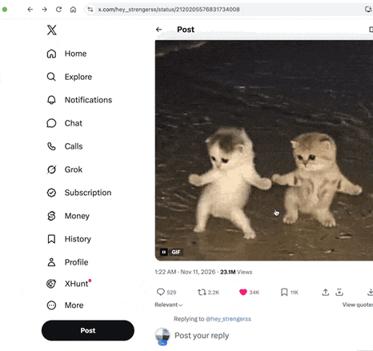
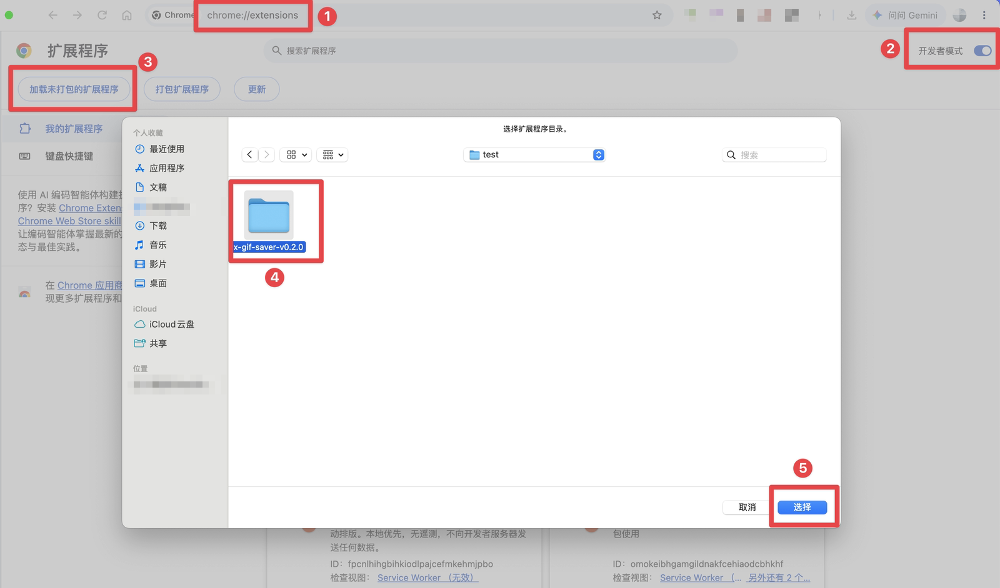

# X GIF Saver

English | [简体中文](README.zh-CN.md)

Save GIFs from X (Twitter) as real `.gif` files, ready to use as reaction GIFs.

X turns uploaded GIFs into MP4 videos, so there is no "Save as GIF" on the web. This Chrome extension adds a Save GIF button to the tweet action bar. One click converts the MP4 back into a GIF right in your browser and downloads it. Nothing is sent to any server.



> Status: **v0.2.1**, not on the Chrome Web Store yet; load it by following [Install](#install). The UI is available in English and Simplified Chinese and follows your browser language. GIFs are saved to `X-GIF/<tweetId>_<author>.gif` in your downloads folder by default. The options page lets you manage conversion presets (size, frame rate, colors, dithering, size limit) and change the folder and file name. Right-click the button to use a different preset once; the browser's context menu works as a fallback. See the [roadmap](docs/ROADMAP.md) (Chinese) for what's next.

## Features

| Feature                                                                                                                                                                          | Status  |
| -------------------------------------------------------------------------------------------------------------------------------------------------------------------------------- | ------- |
| Button in the action bar on the timeline, tweet pages and the media viewer, shown only when the tweet itself has a GIF; GIFs inside quoted tweets are never picked up by mistake | ✅ Done |
| Local conversion: frame-accurate WebCodecs decoding, global palette + ordered dithering + inter-frame diffing, frame timing matches the source                                   | ✅ Done |
| Progress, cancel, retry on failure, double-click protection                                                                                                                      | ✅ Done |
| Right-click the button for a preset menu: use another preset once without changing the default                                                                                   | ✅ Done |
| Presets: Original / Balanced / Sticker, plus custom size, frame rate, colors and size limit (options page)                                                                       | ✅ Done |
| Size limit: if the GIF is too large, it is re-encoded with fewer colors, a lower frame rate and a smaller size; you are told if the limit still can't be met                     | ✅ Done |
| File name template and folder: tweet ID, author and date variables, per-author folders, live preview while typing                                                                | ✅ Done |
| "Save as GIF" in the browser's context menu (fallback when the action bar button is missing)                                                                                     | ✅ Done |
| English and Simplified Chinese UI, following the browser language                                                                                                                | ✅ Done |

Direct messages (XChat) have no tweet action bar, so the button doesn't appear there.

## Install

### From a release (recommended)

Download the latest `x-gif-saver-vX.Y.Z.zip` from [Releases](https://github.com/jiangding01/x-gif-saver/releases/latest) and unzip it somewhere permanent (don't move or delete the folder afterwards). Then:

1. Open `chrome://extensions` in Chrome.
2. Turn on **Developer mode** in the top-right corner.
3. Click **Load unpacked**.
4. Pick the unzipped folder (the one that directly contains `manifest.json`).
5. Click **Select**.



Refresh any open X tabs and the button appears in the tweet action bar. Pin X GIF Saver from the puzzle-piece menu and click its icon to open the options page: tune size, frame rate and colors under presets, and change the folder and file name under save location, with a live example path below.

**Updating**: download and unzip the new zip, replace the contents of the existing folder with the new files (keep the folder in the same place so your settings are kept), click the reload button on the extension's card in `chrome://extensions`, then refresh open X tabs.

### Build from source

Requires Node.js 22+ (needed by WXT 0.21; CI uses Node 24) and pnpm 12. The `.npmrc` in the project root pins the official npm registry, regardless of your global registry settings.

```bash
pnpm install
```

```bash
pnpm build
```

Then follow steps 1 to 5 above and load the `.output/chrome-mv3` folder.

## Development

| Command                       | What it does                                                  |
| ----------------------------- | ------------------------------------------------------------- |
| `pnpm dev`                    | Dev mode: opens Chrome with the extension and hot reload      |
| `pnpm build`                  | Production build to `.output/chrome-mv3`                      |
| `pnpm zip`                    | Package a zip                                                 |
| `pnpm compile`                | Generate WXT types and type-check with TypeScript             |
| `pnpm test`                   | Unit tests (Vitest)                                           |
| `pnpm test:e2e`               | Build, then run end-to-end tests (Playwright, see e2e/README) |
| `pnpm lint` / `pnpm lint:fix` | Biome check / auto-fix                                        |
| `pnpm check`                  | Type check + lint + tests; must pass before committing        |

CI (GitHub Actions) runs `pnpm install --frozen-lockfile`, `pnpm check` and `pnpm build` on every PR and on main, plus a separate end-to-end job (before your first local run, do `pnpm exec playwright install chromium`). Pushing a `vX.Y.Z` tag makes the release workflow package `x-gif-saver-vX.Y.Z.zip` and create a draft release.

## Project layout

```
src/
  adapters/      Site adapters (find GIFs, author, tweet ID)
  core/          Types, message protocol, settings, file names
  pipeline/      Conversion pipeline (runs in a Worker) and encoders; __fixtures__/ holds synthetic test samples
  ui/            Action bar button, right-click preset menu, fallback progress toast (Shadow DOM)
  entrypoints/   background / content script / offscreen / options page
  locales/       UI text: en.json (default) and zh_CN.json, keep the keys in sync
public/icons/    Extension icons (16/32/48/128 PNG + source icon.svg)
e2e/             End-to-end tests (Playwright, sample page and notes)
docs/
  TECH-DESIGN.md Technical design
  ROADMAP.md     Roadmap
  media/         Demo recording and screenshots used in the README
  store/         Chrome Web Store listing copy and dashboard answers
PRIVACY.md       Privacy policy (linked from the store listing)
```

## Docs

Design docs and the changelog are written in Chinese.

- [Technical design](docs/TECH-DESIGN.md): architecture, pipeline, settings schema, permissions, risks, decision log
- [Roadmap](docs/ROADMAP.md): milestones and acceptance criteria
- [CHANGELOG](CHANGELOG.md)
- [Privacy policy](PRIVACY.md) (English and Chinese)

## Privacy

The extension only asks for the `contextMenus`, `downloads`, `offscreen` and `storage` permissions, plus access to `x.com`, `twitter.com` and `video.twimg.com`. All conversion happens locally in your browser; no data is uploaded. See the [privacy policy](PRIVACY.md) for details.

## License

[MIT](LICENSE). If the gifski high-quality encoder (AGPL-3.0, see roadmap M3) is added in the future, license compatibility will need to be reviewed before distribution.
