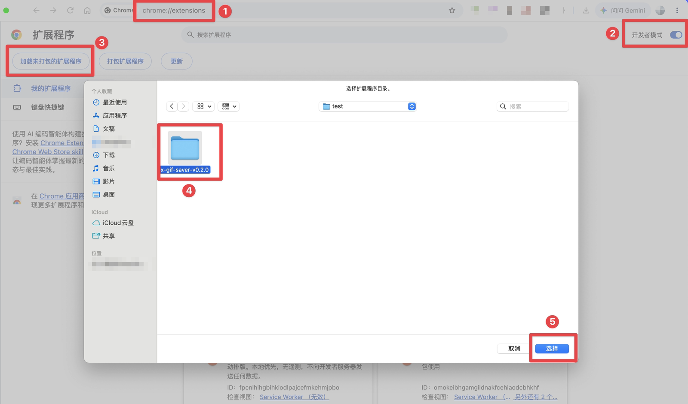

# X GIF Saver

[English](README.md) | 简体中文

一键把 X（Twitter）上的 GIF 保存成真正的 `.gif` 文件，方便当表情包用。

X 会把上传的 GIF 转成 MP4 播放，网页上没法直接另存为 GIF。这个 Chrome 插件在推文操作栏加一个「存 GIF」按钮，点一下就在本地把 MP4 转回 GIF 并下载，不经过任何服务器。


> 当前状态：**v0.2.1**（未上架 Chrome 应用商店，按下方 [安装](#安装) 步骤加载）。界面支持英文和简体中文，跟随浏览器语言。GIF 默认存到下载目录的 `X-GIF/推文ID_作者.gif`；在设置页可以管理转换预设（尺寸、帧率、颜色数、抖动、体积上限），也可以改文件夹和文件名；右键按钮可临时换预设，浏览器右键菜单可兜底保存。后续计划见 [路线图](docs/ROADMAP.md)。

## 功能

| 功能                                                                                       | 状态      |
| ------------------------------------------------------------------------------------------ | --------- |
| 时间线、详情页、大图弹窗中，推文自己带 GIF 时在操作栏显示按钮；引用推文里的 GIF 不会被误下 | ✅ 已完成 |
| 本地转换：WebCodecs 精确逐帧解码，全局调色板 + 有序抖动 + 帧间差分，帧时长与原视频一致     | ✅ 已完成 |
| 转换进度、取消、失败重试，防重复点击                                                       | ✅ 已完成 |
| 右键按钮弹出预设菜单，临时换一个预设下载，不改默认                                         | ✅ 已完成 |
| 预设：原画 / 均衡 / 表情包，可自定义尺寸、帧率、颜色数、体积上限（设置页）                 | ✅ 已完成 |
| 目标体积上限：超出时自动降低颜色、帧率、尺寸重新转换，压不下来会明确提示                   | ✅ 已完成 |
| 文件名模板与保存文件夹：可用推文 ID、作者、日期，文件夹可按作者分，输入时实时显示示例      | ✅ 已完成 |
| 浏览器右键菜单「保存为 GIF」（操作栏按钮失效时兜底）                                       | ✅ 已完成 |
| 界面中英双语，跟随浏览器语言                                                               | ✅ 已完成 |

私信（XChat）里没有推文操作栏，不显示按钮。

## 安装

### 从 Release 安装（推荐）

先到 [Releases](https://github.com/jiangding01/x-gif-saver/releases/latest) 下载最新的 `x-gif-saver-vX.Y.Z.zip`，解压到一个固定的位置（之后不要移动或删除这个文件夹），然后：

1. 在 Chrome 地址栏打开 `chrome://extensions`。
2. 打开右上角的「开发者模式」。
3. 点「加载未打包的扩展程序」。
4. 选中解压出来的文件夹（里面直接就是 `manifest.json`）。
5. 点「选择」。



装好后刷新已打开的 X 页面，推文操作栏就会出现按钮。在拼图菜单里把 X GIF Saver 固定到工具栏，点图标打开设置页：在「转换预设」里调尺寸、帧率和颜色；在「保存位置」里改文件夹和文件名，下方会实时显示示例路径。

**升级**：下载新版 zip 并解压，用新文件替换原文件夹里的内容（文件夹位置不变，设置才会保留），然后在 `chrome://extensions` 的扩展卡片上点刷新按钮，再刷新已打开的 X 页面。

### 从源码构建

需要 Node.js 22+（WXT 0.21 的要求，CI 使用 Node 24）和 pnpm 12。项目根目录的 `.npmrc` 已固定使用 npm 官方源，不受全局源配置影响。

```bash
pnpm install
```

```bash
pnpm build
```

然后按上面第 1 ~ 5 步加载 `.output/chrome-mv3` 目录。

## 开发

| 命令                          | 作用                                            |
| ----------------------------- | ----------------------------------------------- |
| `pnpm dev`                    | 启动开发模式，自动打开带插件的 Chrome 并热更新  |
| `pnpm build`                  | 生产构建到 `.output/chrome-mv3`                 |
| `pnpm zip`                    | 打包 zip                                        |
| `pnpm compile`                | 生成 WXT 类型并做 TypeScript 类型检查           |
| `pnpm test`                   | 单元测试（Vitest）                              |
| `pnpm test:e2e`               | 构建后跑端到端测试（Playwright，见 e2e/README） |
| `pnpm lint` / `pnpm lint:fix` | Biome 检查 / 自动修复                           |
| `pnpm check`                  | 类型检查 + lint + 测试，提交前必须通过          |

CI（GitHub Actions）在每个 PR 和 main 上运行 `pnpm install --frozen-lockfile`、`pnpm check`、`pnpm build`，并另起一个 job 跑端到端测试（首次在本地运行前先 `pnpm exec playwright install chromium`）。推送 `vX.Y.Z` 标签后，Release 工作流会自动打包 `x-gif-saver-vX.Y.Z.zip` 并创建草稿 Release。

## 目录

```
src/
  adapters/      站点适配（识别 GIF、作者、推文 ID）
  core/          类型、消息协议、设置、文件名
  pipeline/      转换流水线（Worker 内运行）与编码器；__fixtures__/ 为合成测试样本
  ui/            操作栏按钮、右键预设菜单、兜底进度提示（Shadow DOM）
  entrypoints/   background / content script / offscreen / 设置页
  locales/       界面文案：en.json（默认）与 zh_CN.json，键名保持一致
public/icons/    插件图标（16/32/48/128 PNG + 原稿 icon.svg）
e2e/             端到端测试（Playwright，样本页面与说明）
docs/
  TECH-DESIGN.md 技术方案
  ROADMAP.md     路线图
  media/         README 用的演示录屏与截图
  store/         Chrome 应用商店上架文案与后台填写内容
PRIVACY.md       隐私政策（商店列表页引用）
```

## 文档

- [技术方案](docs/TECH-DESIGN.md)：架构、流水线、设置结构、权限、风险、决策记录
- [路线图](docs/ROADMAP.md)：里程碑与任务完成标准
- [CHANGELOG](CHANGELOG.md)
- [隐私政策](PRIVACY.md#隐私政策)（中英双语）

## 隐私

只申请 `contextMenus`、`downloads`、`offscreen`、`storage` 权限，以及 `x.com`、`twitter.com`、`video.twimg.com` 的访问权限。所有转换都在浏览器本地完成，不上传任何数据。详见[隐私政策](PRIVACY.md#隐私政策)。

## 许可证

[MIT](LICENSE)。若将来接入 gifski 高质量编码器（AGPL-3.0，见路线图 M3），分发时需另行评估许可证兼容性。
